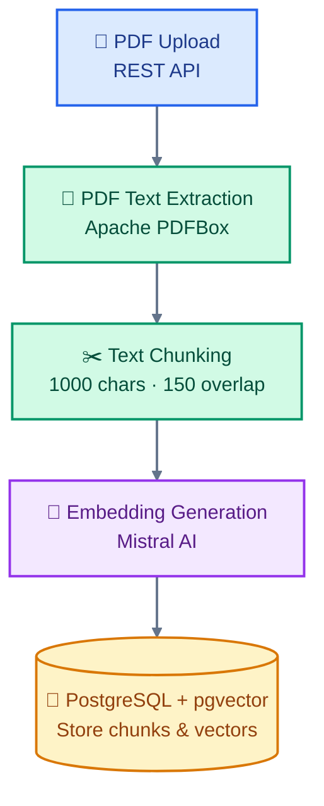

# RAG Chatbot — PDF Ingestion

A Retrieval-Augmented Generation (RAG) project built with Java and Spring
Boot. The current implementation extracts text from PDF documents, splits the
text into chunks, generates embeddings, and stores the resulting documents in
PostgreSQL using pgvector.

## Tech Stack

- Java
- Spring Boot
- Apache PDFBox — PDF text extraction
- Spring AI — embedding model and vector store integration
- Mistral AI — text embeddings using `mistral-embed`
- PostgreSQL + pgvector — vector storage
- Groq API — configured for chat model integration

## Current Features

- Upload a PDF through a REST API.
- Extract text from text-based PDF documents.
- Split extracted text into overlapping chunks.
- Generate embeddings for document chunks through Spring AI.
- Store document content, metadata, and embeddings in pgvector.
- Include the source filename in document metadata.
- Return ingestion details, including the extracted character count and number
  of chunks.

## Ingestion Workflow
## 🏗️ Architecture — PDF Ingestion



## API Endpoint

### Ingest a PDF

**Method:** `POST`

**Endpoint:** `/api/documents/ingest`

**Request content type:** `multipart/form-data`

The PDF must be provided using the form field named `file`.

```bash
curl -X POST http://localhost:8080/api/documents/ingest \
  -F "file=@/path/to/document.pdf"
```

The response reports the filename, extracted character count, number of
chunks, and ingestion status.

## Configuration

Configure the application using `application.yml` and environment variables.

The current configuration requires:

- `MISTRAL_AI` — Mistral API key used for embeddings.
- `GROK_AI` — API key variable currently configured for the Groq-compatible
  chat endpoint.

Do not commit API keys or other secrets to Git.

## Database

The local development configuration uses PostgreSQL with the database name
`ragdb2`.

Before starting the application, ensure that:

1. PostgreSQL is running.
2. The `ragdb2` database exists.
3. The configured database user has the necessary permissions.
4. The pgvector extension and vector-store schema are available as required by
   the project's Spring AI configuration.

## Current Chunking

The ingestion service currently uses:

- Chunk size: 1,000 characters
- Overlap: 150 characters

These are character-based settings, not token counts. The chunking strategy and
retrieval quality can be evaluated and improved in later iterations.

## Current Limitations

- Extraction currently supports text-based PDFs; scanned PDFs may require OCR.
- Chunking is character-based rather than token-based.
- Semantic retrieval has not yet been implemented and tested.
- LLM answer generation from retrieved context is not yet implemented.

## Next Milestone

Implement and test similarity-based retrieval of relevant document chunks using
a user's question. LLM answer generation from the retrieved context will
follow after retrieval has been verified independently.
